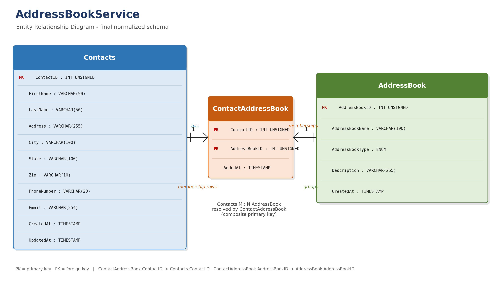
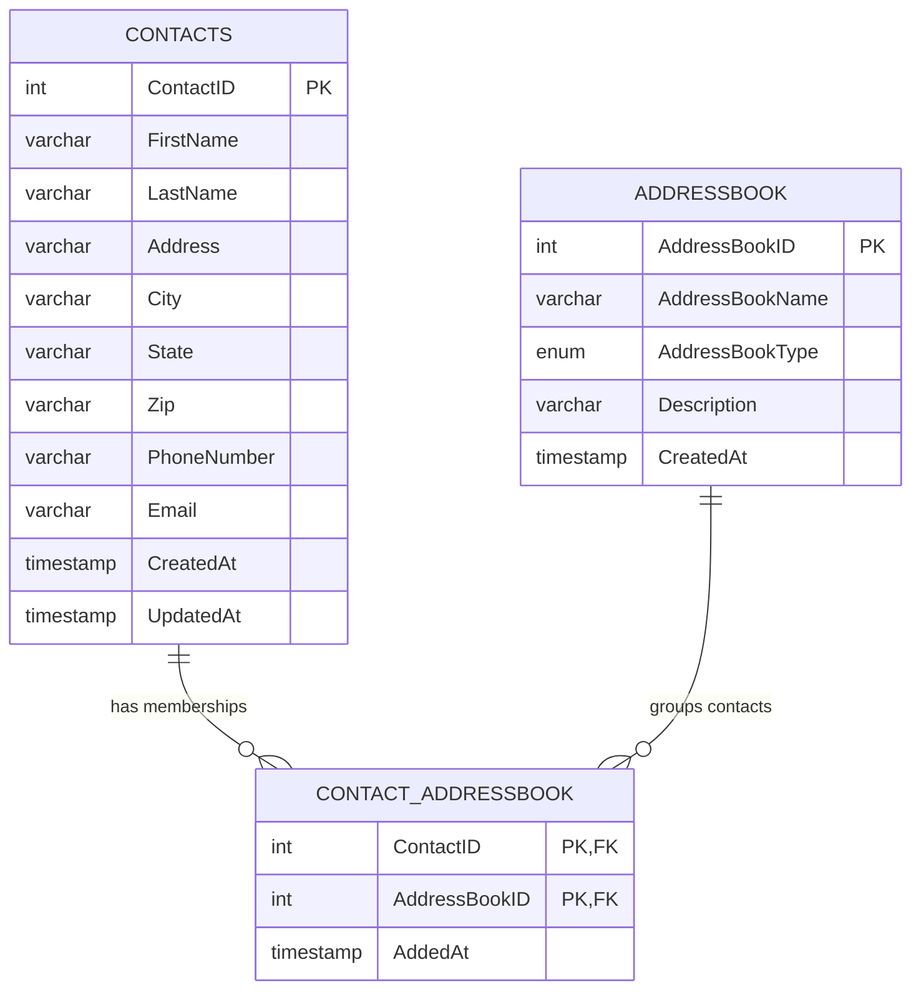

# AddressBook ER Diagram

The diagram is also available as a vector file:
[`AddressBook_ER_Diagram.svg`](AddressBook_ER_Diagram.svg).

## Entities

### Contacts

Stores one row per person. A person is never duplicated just because they
belong to several address books.

| Attribute | Type | Key |
| --- | --- | --- |
| `ContactID` | `INT UNSIGNED` | PK, auto-increment |
| `FirstName` | `VARCHAR(50)` | Part of candidate key |
| `LastName` | `VARCHAR(50)` | Part of candidate key |
| `Address` | `VARCHAR(255)` |  |
| `City` | `VARCHAR(100)` |  |
| `State` | `VARCHAR(100)` |  |
| `Zip` | `VARCHAR(10)` |  |
| `PhoneNumber` | `VARCHAR(20)` | Part of candidate key |
| `Email` | `VARCHAR(254)` | Unique candidate key |
| `CreatedAt` | `TIMESTAMP` |  |
| `UpdatedAt` | `TIMESTAMP` |  |

### AddressBook

Stores each named address book and its type.

| Attribute | Type | Key |
| --- | --- | --- |
| `AddressBookID` | `INT UNSIGNED` | PK, auto-increment |
| `AddressBookName` | `VARCHAR(100)` | Unique together with type |
| `AddressBookType` | `ENUM('Family','Friends','Professional')` | Unique together with name |
| `Description` | `VARCHAR(255)` |  |
| `CreatedAt` | `TIMESTAMP` |  |

### ContactAddressBook

Junction entity that resolves the many-to-many relationship between contacts
and address books.

| Attribute | Type | Key |
| --- | --- | --- |
| `ContactID` | `INT UNSIGNED` | PK part 1, FK to `Contacts` |
| `AddressBookID` | `INT UNSIGNED` | PK part 2, FK to `AddressBook` |
| `AddedAt` | `TIMESTAMP` |  |

## Relationships and Cardinalities

| Parent | Child | Cardinality | Meaning |
| --- | --- | --- | --- |
| `Contacts` | `ContactAddressBook` | 1 : N | One contact can have many membership rows. |
| `AddressBook` | `ContactAddressBook` | 1 : N | One address book can contain many membership rows. |
| `Contacts` | `AddressBook` | M : N | A contact may belong to many address books, and an address book may contain many contacts. |

Each `ContactAddressBook` row is unique because its composite primary key is
`(ContactID, AddressBookID)`. Both foreign keys use `ON DELETE CASCADE` and
`ON UPDATE CASCADE`, so deleting a contact or address book removes only the
related membership rows.

## Mermaid Source

See [Normalization.md](Normalization.md) for the normalization analysis and key
definitions.
